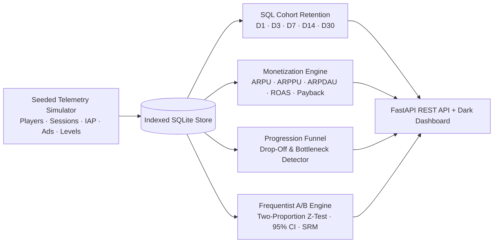

<div align="center">
  
</div>

<p align="center">
  
  
  
  
</p>

Mobile game and consumer app **product analytics, monetization modeling, and statistical A/B experimentation engine** built with Python, indexed SQLite analytical queries, and FastAPI.

## Architecture



## Core Capabilities

- **SQL Cohort Retention Matrix (`compute_cohort_retention`):** Computes D1, D3, D7, D14, and D30 retention curves via SQLite CTEs & `julianday` offsets, filterable by acquisition channel (`apple_search_ads`, `meta_ua`, `organic`).
- **LTV, ROAS & Payback Modeling (`compute_ltv_summary`):** Calculates Payer Conversion %, ARPU, ARPPU, ARPDAU, campaign ROAS %, and estimated CPI payback days.
- **Funnel Bottleneck Diagnostics (`compute_funnel_report`):** Tracks step-to-step onboarding/level conversion and automatically identifies the steepest drop-off bottleneck.
- **Zero-SciPy Statistical A/B Test Engine (`analyze_ab_test`):** Two-proportion Z-test using standard-library `math.erf`, two-tailed p-value, 95% Wald confidence interval, and a **Chi-Square Sample Ratio Mismatch (SRM)** guard that invalidates skewed splits automatically.
- **Live FastAPI REST API & Executive Dashboard:** Exposes `/api/retention`, `/api/monetization`, `/api/funnel`, `/api/experiments/paywall`, and a dark-mode executive UI at `/`.

## Quick Start

```bash
git clone https://github.com/Bugraciftci/GamePulse-Analytics.git
cd GamePulse-Analytics
pip install -r requirements.txt

# Launch FastAPI dashboard on http://127.0.0.1:8000
PYTHONPATH=src uvicorn gamepulse.api:app --reload
```

### Run Tests

```bash
python3 -m unittest discover -s tests -v
```

### Run with Docker

```bash
docker build -t gamepulse-analytics .
docker run -p 8000:8000 gamepulse-analytics
```

## License

MIT — see [LICENSE](./LICENSE).
